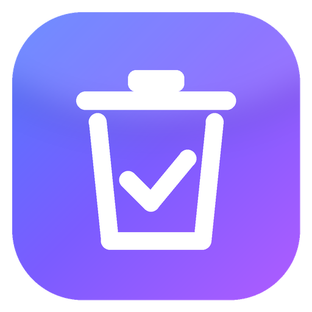
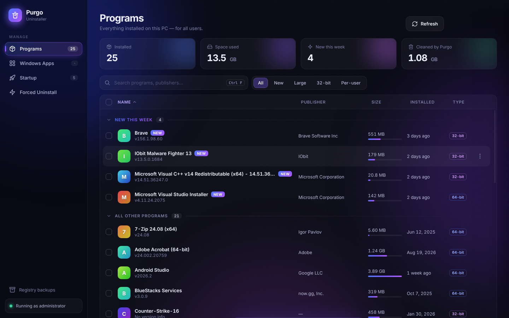
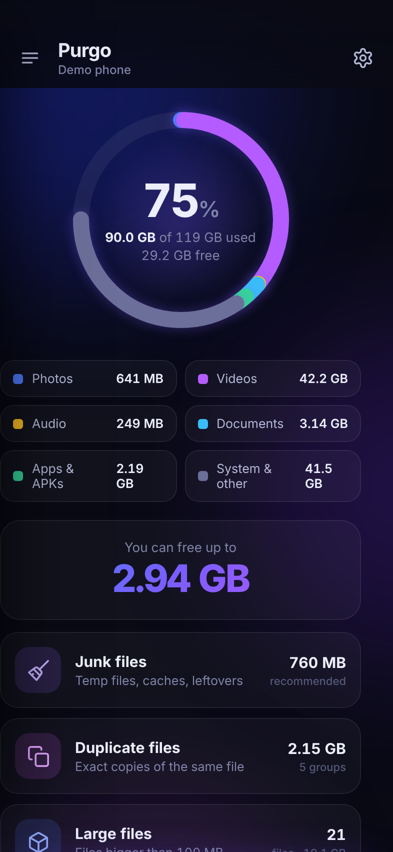
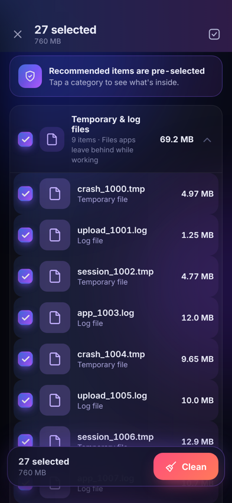
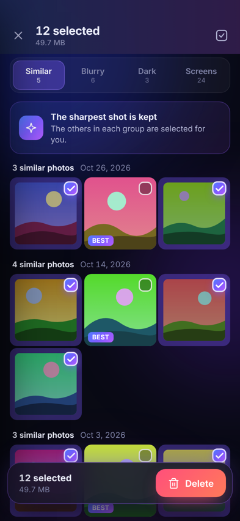
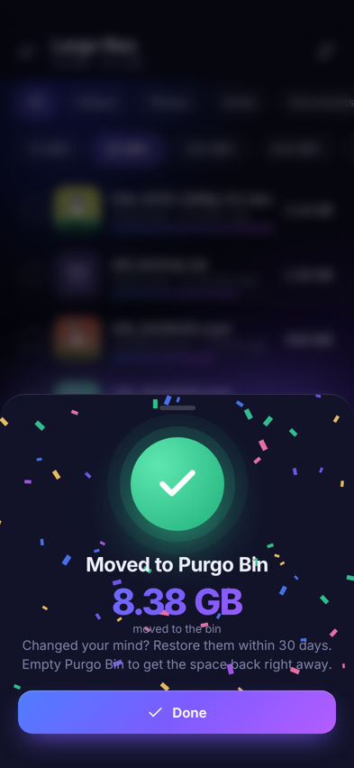
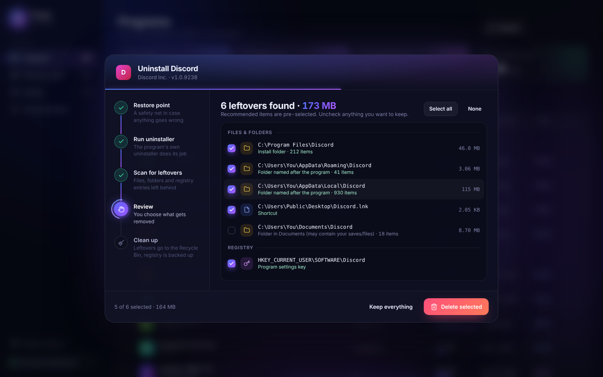
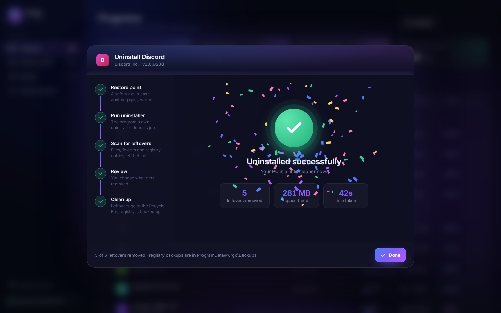
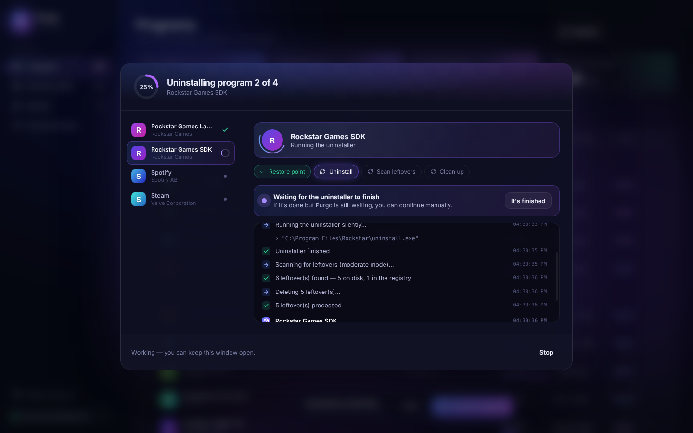
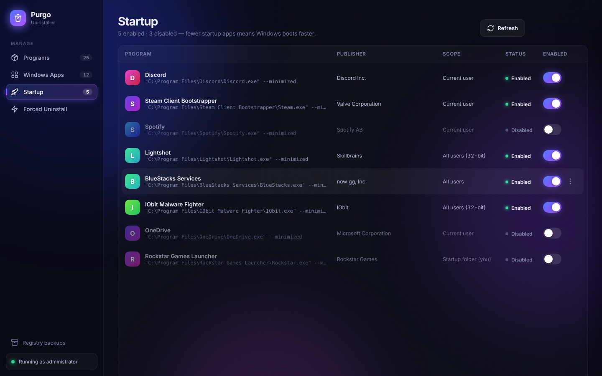

<p align="center"></p>

<h1 align="center">Purgo</h1>
<p align="center"><b>A modern uninstaller for Windows</b> — removes programs <i>and</i> everything they leave behind.</p>
<p align="center">
  <a href="https://github.com/laslobogdan-create/purgo/releases/latest">Download</a> ·
  <a href="#features">Features</a> ·
  <a href="#code-signing-policy">Code signing policy</a> ·
  <a href="#privacy">Privacy</a>
</p>

<p align="center"></p>

## What it does

Most uninstallers that ship with programs leave things behind: folders in AppData, settings in the registry, shortcuts, startup entries. Purgo runs the program's own uninstaller first, then scans for those leftovers and lets you remove them — with a clear, animated step-by-step view of everything it does.

## Features

- **Programs** — every installed program (all users, 32- and 64-bit) with size, version, install date and publisher. Search, filter (new, large, 32-bit, per-user) and sort.
- **Step-by-step uninstall** — optional System Restore point → the program's own uninstaller → leftover scan → you review → clean-up.
- **Batch uninstall** — tick several programs and Purgo removes them one after another, using silent mode where the program supports it.
- **Three scan modes** — Safe, Moderate (recommended) and Advanced.
- **Forced Uninstall** — clean up traces of a program that is broken, half-removed or missing from the list.
- **Windows Apps** — remove Microsoft Store apps.
- **Startup manager** — enable, disable or delete programs that start with Windows (same mechanism as Task Manager).

## Purgo for Android

The same idea, for your phone: find what's eating your storage and clean it with a tap.

<p align="center">
  
  
  
  
</p>

- **Smart scan** — storage overview with everything you can free in one place.
- **Junk files** — temp and log files, thumbnail cache, installer files of apps you already have, leftovers of removed apps, empty folders.
- **Large files** — sorted by size, filter by type, preview before deleting.
- **Duplicates** — byte-identical copies; the original is kept automatically.
- **Smart photos** — similar shots (keeps the sharpest), blurry, very dark photos and old screenshots. Analysed on the phone.
- **WhatsApp & Telegram** — received and sent photos, videos, voice notes and documents by category.
- **Apps** — sizes, cache, last used, unused-app filter and multi-uninstall.
- **App cache** — cache per app and "clean all app caches" (Android 11+).
- **Storage explorer** and **Purgo Bin** — everything you delete can be restored for 30 days.

Download `Purgo-x.y.z.apk` from the [Android releases](https://github.com/laslobogdan-create/purgo/releases?q=android&expanded=true). Requires Android 8.0+.
Purgo needs **All files access** (to find and delete files) and, optionally, **Usage access** (app sizes and last-used times). It works fully offline: nothing about your files or apps ever leaves the phone.

## Safety first

- Files and folders are moved to the **Recycle Bin**, not deleted permanently.
- Every registry key and value is **exported to a .reg backup** (`C:\ProgramData\Purgo\Backups`) before it is removed. If the backup fails, nothing is deleted.
- Only leftovers that clearly belong to the program are pre-selected. Folders shared with other installed programs, folders in Documents and anything with user content (like game libraries) are never selected automatically.
- System folders, user profile roots and core registry keys are hard-blocked and can never be removed.

<p align="center">
  
  
</p>
<p align="center">
  
  
</p>

## Download

Get the latest `Purgo-x.y.z-Portable.exe` from the [Releases page](https://github.com/laslobogdan-create/purgo/releases/latest). It is portable — no installation needed — and asks for administrator rights because removing programs for all users requires them.

Requires Windows 10 or 11 (64-bit).

## Building from source

```bash
npm ci
npm start          # run in development (demo data on non-Windows systems)
npm run dist       # build dist/Purgo-<version>-Portable.exe
```

Official release binaries are built only by the GitHub Actions workflow in [`.github/workflows/release.yml`](.github/workflows/release.yml), directly from the source in this repository.

## Code signing policy

Free code signing provided by [SignPath.io](https://about.signpath.io), certificate by [SignPath Foundation](https://signpath.org).

- **What is signed:** only the Windows release binaries (`Purgo-*-Portable.exe`) published on this repository's [Releases page](https://github.com/laslobogdan-create/purgo/releases).
- **How they are built:** exclusively by GitHub Actions from the public source code in this repository. No binary built on a personal computer is ever signed.
- **Approval:** every signing request is manually approved by the project approver before signing.

**Team roles**

| Role | Members |
|---|---|
| Committers and reviewers | [Vasili Zaitev](https://github.com/laslobogdan-create) |
| Approvers | [Vasili Zaitev](https://github.com/laslobogdan-create) |

All team members use multi-factor authentication for GitHub and SignPath.

See also [CODE_SIGNING_POLICY.md](CODE_SIGNING_POLICY.md).

## Privacy

This program will not transfer any information to other networked systems unless specifically requested by the user or the person installing or operating it.

Purgo works entirely on your computer. It has no telemetry, no analytics, no accounts and no automatic update checks. The only network actions happen when **you** click "Search online" or "Open website" for a program, which opens your web browser. See [PRIVACY.md](PRIVACY.md).

## License

Copyright © 2026 Vasili Zaitev. Released under the [GNU General Public License v3.0](LICENSE).
